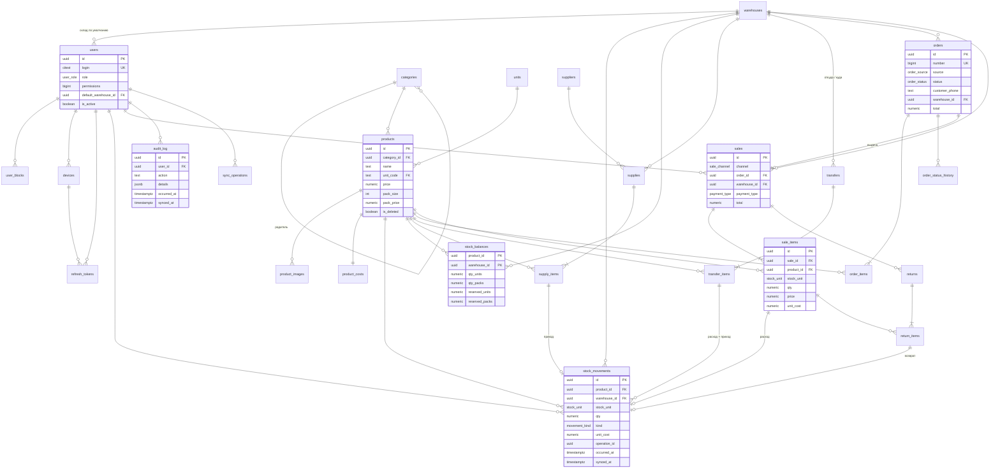

# Budmaster — проект системы (Шаг 1)

Статус: согласовано, кроме пунктов с пометкой «Предложение». Кода нет. Пункты с пометкой **«Предложение»** — мои решения там, где ответ был неоднозначным или «сам реши»; их нужно подтвердить или поправить.

Содержание:
1. [Решения, требующие подтверждения](#1-решения-требующие-подтверждения)
2. [План по этапам](#2-план-по-этапам)
3. [Общие правила модели данных](#3-общие-правила-модели-данных)
4. [Схема PostgreSQL](#4-схема-postgresql)
5. [ER-диаграмма](#5-er-диаграмма)
6. [Себестоимость и отчёты](#6-себестоимость-и-отчёты)
7. [Права доступа (битовая маска)](#7-права-доступа-битовая-маска)
8. [Сущности Room](#8-сущности-room-android)
9. [Синхронизация и конфликты](#9-синхронизация-и-конфликты)
10. [Вход и безопасность](#10-вход-и-безопасность)
11. [Архивация](#11-архивация)
12. [API](#12-api)
13. [Инфраструктура](#13-инфраструктура)

---

## 1. Решения, требующие подтверждения

| № | Вопрос | Предложение |
|---|--------|-------------|
| P1 | Язык сайта. | **Подтверждено:** только украинский, без vue-i18n и переключателя. |
| P2 | Язык приложения. | **Подтверждено:** интерфейс Android и все данные — на украинском. |
| P3 | Когда начинается резерв. | **Подтверждено:** при переходе в «подтверждён» (тогда же работник выбирает склад). Списание — при «выдан/доставлен». Отмена снимает резерв. |
| P4 | Цена в заказе. | **Подтверждено:** фиксируется при создании заказа. Вручную цену строки до выдачи может изменить только владелец, правка идёт в лог. |
| P5 | Канал для заказов, внесённых работником вручную. | **Подтверждено:** хранится отдельно (`manual`), в разбивке «сайт / касса» относится к «кассе». |
| P6 | Кто вводит закупочную цену. | **Решено:** работник при приёмке вводит цену из накладной и видит закупочные цены в поставках. Среднюю себестоимость, себестоимость продаж и прибыль видит только владелец. |
| P7 | Оборот и выручка. | **Подтверждено:** оборот — сумма всех продаж; выручка — оборот минус возвраты; прибыль — выручка минус себестоимость проданного; списания — отдельной строкой «потери». |
| P8 | Что архивируется. | **Подтверждено:** журнал действий и служебный реестр — 3 месяца в БД, затем в архив. Продажи, заказы, поставки, перемещения, возвраты, движения товара — 12 месяцев в БД, затем в архив. Архивация раз в месяц. Подробности — раздел 11. |
| P9 | Чтение архива из приложения. | **Подтверждено:** владелец может открыть любой архивный месяц (только чтение, нужен интернет). |
| P10 | Уведомления о новых заказах. | **Подтверждено:** опрос сервера каждые 15 минут (в фоне и при открытом приложении), плюс обновление вручную. |
| P11 | Блокировка сотрудника, когда устройство офлайн. | **Решено:** операции до блокировки принимаются, сделанные во время блокировки — отклоняются и пишутся в лог. |
| P12 | Количество. | **Подтверждено:** до трёх знаков после запятой; у единицы измерения флаг «дробное разрешено» (кг, м, м², м³ — да; шт, мешок, лист, пачка — нет). |
| P13 | Наличие на сайте. | **Подтверждено:** три состояния — «в наявності», «скоро з’явиться», «немає в наявності». «Скоро появится» — остатка нет, но есть запланированная поставка этого товара; иначе «нет в наличии». Остаток считается по сумме обоих складов: пачки пересчитаны в штуки, резерв вычтен. Цифр и складов в публичном API нет. |
| P14 | Фото товаров. | **Подтверждено:** загрузка из приложения (камера или галерея), до 5 фото на товар, сервер делает уменьшенные копии. Только онлайн. |
| P15 | Фискализация (ПРРО). | **Подтверждено:** вне проекта. Тип оплаты хранится. |
| P16 | Возврат от покупателя. | **Подтверждено:** отдельный документ, привязан к продаже; товар возвращается на склад, выручка уменьшается в том же канале; брак затем списывается. Если продажа уже в архиве (старше года) — возврат без привязки к продаже. **Предложение:** оформлять возврат может работник. |
| P17 | Сброс пароля. | **Подтверждено:** владелец задаёт работнику временный пароль; при первом входе работник обязан его сменить. Пароли владельцев — только через CLI. |
| P18 | Продажа с кассы офлайн, когда цену изменили. | **Подтверждено:** продажа принимается по цене с устройства, в журнале пометка «цена отличалась от текущей». |

---

## 2. План по этапам

После каждого этапа — остановка и подтверждение. Вся работа в ветке `dev`; `master` не меняется, пока не готово (Netlify собирает `master`).

**Правило слияния.** Пока сайт работает на демонстрационных данных, `dev` в `master` не сливается: на моках цены выдуманные, а форма заявки показывает «заявку принято», но никуда её не отправляет — клиенты теряли бы заказы. Сливать можно после этапа 5, когда каталог и заявки идут через настоящий сервер.

| Этап | Содержание | Результат |
|------|------------|-----------|
| 0 | Перенос сайта в `/site`, `netlify.toml` (base = `site`), логотипы и favicon | Старый сайт собирается из новой папки |
| 1 | Редизайн сайта: Tailwind + shadcn-vue, светлая/тёмная тема, каталог, корзина, форма заявки. Моки по формату API из раздела 12 | Готовый сайт на моках |
| 2 | Бэкенд, основа: Docker Compose, миграции, вход, токены, CLI создания владельцев, сотрудники, права, журнал действий | Работает вход и управление сотрудниками |
| 3 | Бэкенд, каталог: категории, товары, фото, публичное API, импорт каталога из файла. Каталог сайта переключается с моков на API; форма заявки остаётся на моках до этапа 5 | Сайт берёт каталог с сервера. Настоящие товары появятся, когда их начнут вводить из приложения (этапы 4 и 6) или импортируют файлом; до того на сервере демо-каталог |
| 4 | Бэкенд, склад: движения, остатки, поставки, перемещения, вскрытие пачек, списания, синхронизация (push/pull) | Учёт остатков через API |
| 5 | Бэкенд, продажи: заказы, касса, возвраты, себестоимость, отчёты, архивация логов. Форма заявки сайта подключается к API | Сервер готов полностью |
| 6 | Android, основа: Room, вход и PIN, движок синхронизации, каталог и остатки офлайн | Приложение показывает товары и остатки |
| 7 | Android, операции: поставки, перемещения, пачки, списания, касса, возвраты | Работник ведёт учёт |
| 8 | Android, заказы: список, ручной ввод, статусы, нехватка товара, уведомления | Обработка заказов |
| 9 | Android, владелец: сотрудники и права, журнал, отчёты | Функции владельца |
| 10 | Деплой: сервер, TLS, резервные копии, подписанный APK | Система в работе |

---

## 3. Общие правила модели данных

- **Идентификаторы.** Все первичные ключи — UUID, создаются на устройстве (или на сервере для заказов с сайта). Повторная отправка той же записи ничего не дублирует.
- **Остаток не хранится как число.** Хранятся движения (`stock_movements`), остаток — их сумма. Таблица `stock_balances` — кэш, который обновляется в той же транзакции и может быть пересчитан с нуля CLI-командой.
- **Два вида остатка у товаров с фасовкой.** Каждое движение и каждая строка документа имеет `stock_unit`: `unit` (базовая единица товара, для крепежа — штука) или `pack` (пачка). Остаток хранится раздельно.
- **Отрицательный остаток разрешён.**
- **Время.** У каждой записи с устройства два времени: `occurred_at` (когда сделано на устройстве) и `synced_at` (когда принял сервер). Все — `timestamptz`.
- **Мягкое удаление.** `is_deleted` у товаров, категорий, поставщиков; `is_active` у сотрудников и складов. Физического удаления нет.
- **Деньги** — `numeric(12,2)`, гривна. **Количество** — `numeric(14,3)`. **Себестоимость за единицу** — `numeric(14,4)`.
- **Счётчик изменений.** У таблиц, которые скачивает приложение, есть `change_seq bigint` из общей последовательности — по нему устройство запрашивает «всё, что изменилось после N» (см. 9.3).

---

## 4. Схема PostgreSQL

Перечисления (enum):

| Тип | Значения |
|-----|----------|
| `user_role` | `owner`, `worker` |
| `stock_unit` | `unit`, `pack` |
| `movement_kind` | `receipt`, `sale`, `return`, `write_off`, `adjustment`, `pack_open`, `transfer_out`, `transfer_in` |
| `supply_status` | `planned`, `received`, `cancelled` |
| `order_source` | `site`, `manual` |
| `order_status` | `new`, `confirmed`, `assembled`, `completed`, `cancelled` |
| `delivery_type` | `pickup`, `delivery` |
| `sale_channel` | `site`, `manual`, `pos` |
| `payment_type` | `cash`, `terminal`, `card_transfer`, `bank_transfer`, `e_vidnovlennia` |

### 4.1 Сотрудники и доступ

**`warehouses`**

| Поле | Тип | Ограничения |
|------|-----|-------------|
| id | uuid | PK |
| name | text | NOT NULL, UNIQUE |
| address | text | NULL |
| is_active | boolean | NOT NULL DEFAULT true |
| created_at, updated_at | timestamptz | NOT NULL |
| change_seq | bigint | NOT NULL, индекс |

**`users`**

| Поле | Тип | Ограничения |
|------|-----|-------------|
| id | uuid | PK |
| login | citext | NOT NULL, UNIQUE |
| password_hash | text | NOT NULL (argon2id) |
| first_name, last_name | text | NOT NULL |
| role | user_role | NOT NULL |
| permissions | bigint | NOT NULL DEFAULT 0 (см. раздел 7) |
| default_warehouse_id | uuid | FK → warehouses, NULL для владельца допустим |
| is_active | boolean | NOT NULL DEFAULT true |
| must_change_password | boolean | NOT NULL DEFAULT false |
| created_at, updated_at | timestamptz | NOT NULL |
| change_seq | bigint | NOT NULL, индекс |

**`user_blocks`** — история блокировок. Нужна, чтобы после разблокировки не принять операции, сделанные во время блокировки.

| Поле | Тип | Ограничения |
|------|-----|-------------|
| id | uuid | PK |
| user_id | uuid | FK → users, NOT NULL, индекс |
| blocked_at | timestamptz | NOT NULL |
| blocked_by | uuid | FK → users, NOT NULL |
| unblocked_at | timestamptz | NULL |
| unblocked_by | uuid | FK → users, NULL |

**`devices`**

| Поле | Тип | Ограничения |
|------|-----|-------------|
| id | uuid | PK (создаётся на устройстве при установке) |
| user_id | uuid | FK → users, NOT NULL, индекс |
| model | text | NULL |
| registered_at | timestamptz | NOT NULL |
| last_sync_at | timestamptz | NULL |
| revoked_at | timestamptz | NULL |

**`refresh_tokens`**

| Поле | Тип | Ограничения |
|------|-----|-------------|
| id | uuid | PK |
| user_id | uuid | FK → users, NOT NULL, индекс |
| device_id | uuid | FK → devices, NOT NULL |
| family_id | uuid | NOT NULL, индекс (цепочка ротации) |
| token_hash | bytea | NOT NULL, UNIQUE (SHA-256, сам токен не хранится) |
| expires_at | timestamptz | NOT NULL |
| used_at, revoked_at | timestamptz | NULL |
| created_at | timestamptz | NOT NULL |

### 4.2 Каталог

**`units`** — справочник, заполняется миграцией.

| Поле | Тип | Ограничения |
|------|-----|-------------|
| code | text | PK (`pcs`, `kg`, `bag`, `sheet`, `m`, `m2`, `m3`, `l`, …) |
| name | text | NOT NULL («штука», «мішок»…) |
| short_name | text | NOT NULL («шт», «кг», «м²») |
| allow_fraction | boolean | NOT NULL |

**`categories`**

| Поле | Тип | Ограничения |
|------|-----|-------------|
| id | uuid | PK |
| parent_id | uuid | FK → categories, NULL, индекс; CHECK `parent_id <> id` |
| name | text | NOT NULL |
| slug | text | NOT NULL, UNIQUE |
| sort_order | int | NOT NULL DEFAULT 0 |
| is_deleted | boolean | NOT NULL DEFAULT false |
| updated_at | timestamptz | NOT NULL |
| change_seq | bigint | NOT NULL, индекс |

Циклы в дереве запрещает сервер при сохранении.

**`products`**

| Поле | Тип | Ограничения |
|------|-----|-------------|
| id | uuid | PK |
| category_id | uuid | FK → categories, NOT NULL, индекс |
| name | text | NOT NULL |
| description | text | NOT NULL DEFAULT '' |
| unit_code | text | FK → units, NOT NULL |
| price | numeric(12,2) | NOT NULL, CHECK ≥ 0 |
| pack_size | int | NULL, CHECK > 1 |
| pack_price | numeric(12,2) | NULL, CHECK ≥ 0 |
| is_published | boolean | NOT NULL DEFAULT true (показывать на сайте) |
| is_deleted | boolean | NOT NULL DEFAULT false |
| field_updated_at | jsonb | NOT NULL DEFAULT '{}' (время последней правки каждого поля, см. 9.4) |
| created_at, updated_at | timestamptz | NOT NULL |
| change_seq | bigint | NOT NULL, индекс |

- CHECK: `pack_size` и `pack_price` либо оба NULL, либо оба заполнены.
- `pack_size` нельзя изменить после первого движения товара в пачках — иначе старые пачки пересчитаются неверно. Другая фасовка = новый товар.
- Индексы: GIN по триграммам `name` (поиск с опечатками, расширение `pg_trgm`); частичный индекс `(category_id) WHERE NOT is_deleted AND is_published`.

**`product_images`**

| Поле | Тип | Ограничения |
|------|-----|-------------|
| id | uuid | PK |
| product_id | uuid | FK → products, NOT NULL |
| file_path, thumb_path | text | NOT NULL |
| sort_order | int | NOT NULL DEFAULT 0 |
| is_deleted | boolean | NOT NULL DEFAULT false |
| created_by | uuid | FK → users |
| created_at | timestamptz | NOT NULL |
| change_seq | bigint | NOT NULL, индекс |

Индекс `(product_id, sort_order)`.

Адрес категории на сайте (`slug`) сервер строит сам из названия: украинская кириллица → латиница («Цемент і сухі суміші» → `tsement-i-sukhi-sumishi`). При совпадении добавляется номер: `tsehla-2`. Адрес не меняется при переименовании категории, чтобы не ломать ссылки.

Наличие для сайта (`in_stock` / `coming_soon` / `out_of_stock`) считает одна функция базы `product_availability`. Пока остатков и поставок нет, она у всех товаров возвращает «немає в наявності»; на этапе 4 её заменит миграция.

**`product_costs`** — отдельно от `products`, чтобы себестоимость не уходила на устройства работников.

| Поле | Тип | Ограничения |
|------|-----|-------------|
| product_id | uuid | PK, FK → products |
| avg_cost | numeric(14,4) | NOT NULL DEFAULT 0 (за базовую единицу) |
| updated_at | timestamptz | NOT NULL |

**`suppliers`**

| Поле | Тип | Ограничения |
|------|-----|-------------|
| id | uuid | PK |
| name | text | NOT NULL |
| contact_person, phone, note | text | NULL |
| is_deleted | boolean | NOT NULL DEFAULT false |
| updated_at | timestamptz | NOT NULL |
| change_seq | bigint | NOT NULL, индекс |

### 4.3 Склад

**`stock_movements`** — главная таблица учёта. Только добавление.

| Поле | Тип | Ограничения |
|------|-----|-------------|
| id | uuid | PK |
| seq | bigserial | UNIQUE (порядок принятия сервером) |
| product_id | uuid | FK → products, NOT NULL |
| warehouse_id | uuid | FK → warehouses, NOT NULL |
| stock_unit | stock_unit | NOT NULL |
| qty | numeric(14,3) | NOT NULL, CHECK ≠ 0 (плюс — приход, минус — расход) |
| kind | movement_kind | NOT NULL |
| unit_cost | numeric(14,4) | NULL (для прихода — закупочная цена; для расхода — себестоимость на момент проведения) |
| operation_id | uuid | NOT NULL (объединяет строки одной операции, например вскрытие пачки = 2 строки) |
| supply_item_id | uuid | FK → supply_items, NULL |
| sale_item_id | uuid | FK → sale_items, NULL |
| return_item_id | uuid | FK → return_items, NULL |
| transfer_item_id | uuid | FK → transfer_items, NULL |
| reason | text | NULL; CHECK: обязательно для `write_off` и `adjustment` |
| user_id | uuid | FK → users, NOT NULL |
| device_id | uuid | FK → devices, NULL |
| occurred_at | timestamptz | NOT NULL |
| synced_at | timestamptz | NOT NULL DEFAULT now() |

- Индексы: `(product_id, warehouse_id)`, `(warehouse_id, occurred_at)`, `(kind, occurred_at)`, `(operation_id)`.
- Защита от двойного проведения — частичные уникальные индексы: `(supply_item_id) WHERE kind = 'receipt'`, `(sale_item_id) WHERE kind = 'sale'`, `(return_item_id) WHERE kind = 'return'`, `(transfer_item_id, kind)`.
- Триггер запрещает UPDATE и DELETE; у роли приложения в БД на эту таблицу есть только INSERT и SELECT.

**`stock_balances`** — кэш.

| Поле | Тип | Ограничения |
|------|-----|-------------|
| product_id | uuid | PK (составной), FK → products |
| warehouse_id | uuid | PK (составной), FK → warehouses |
| qty_units | numeric(14,3) | NOT NULL DEFAULT 0 |
| qty_packs | numeric(14,3) | NOT NULL DEFAULT 0 |
| reserved_units | numeric(14,3) | NOT NULL DEFAULT 0 |
| reserved_packs | numeric(14,3) | NOT NULL DEFAULT 0 |
| updated_at | timestamptz | NOT NULL |
| change_seq | bigint | NOT NULL, индекс |

Резерв — не движение: это сумма строк заказов в статусах `confirmed` и `assembled` на этом складе.

**`supplies`** — поставка. Может быть создана заранее (`planned`) или сразу как принятая.

| Поле | Тип | Ограничения |
|------|-----|-------------|
| id | uuid | PK |
| number | bigint | UNIQUE, из последовательности |
| supplier_id | uuid | FK → suppliers, NOT NULL, индекс |
| warehouse_id | uuid | FK → warehouses, NOT NULL |
| status | supply_status | NOT NULL |
| expected_on | date | NULL |
| note | text | NULL |
| created_by | uuid | FK → users, NOT NULL |
| created_at | timestamptz | NOT NULL (время на устройстве) |
| received_by | uuid | FK → users, NULL |
| received_at | timestamptz | NULL; CHECK: заполнено ⇔ `status = 'received'` |
| synced_at | timestamptz | NOT NULL |
| change_seq | bigint | NOT NULL, индекс |

**`supply_items`**

| Поле | Тип | Ограничения |
|------|-----|-------------|
| id | uuid | PK |
| supply_id | uuid | FK → supplies, NOT NULL |
| product_id | uuid | FK → products, NOT NULL |
| stock_unit | stock_unit | NOT NULL |
| expected_qty | numeric(14,3) | NULL (NULL — поставка без предварительного заказа), CHECK > 0 |
| received_qty | numeric(14,3) | NULL до приёмки, CHECK ≥ 0 |
| unit_cost | numeric(14,4) | NULL до приёмки, CHECK ≥ 0 (цена за `stock_unit`) |

UNIQUE `(supply_id, product_id, stock_unit)`. Если `received_qty ≠ expected_qty`, в журнал пишется запись «расхождение» с обеими цифрами.

**`transfers`** / **`transfer_items`** — перемещение, одно действие.

| Поле (`transfers`) | Тип | Ограничения |
|------|-----|-------------|
| id | uuid | PK |
| from_warehouse_id, to_warehouse_id | uuid | FK → warehouses, NOT NULL, CHECK различаются |
| note | text | NULL |
| user_id | uuid | FK → users, NOT NULL |
| occurred_at, synced_at | timestamptz | NOT NULL |

| Поле (`transfer_items`) | Тип | Ограничения |
|------|-----|-------------|
| id | uuid | PK |
| transfer_id | uuid | FK → transfers, NOT NULL |
| product_id | uuid | FK → products, NOT NULL |
| stock_unit | stock_unit | NOT NULL |
| qty | numeric(14,3) | NOT NULL, CHECK > 0 |

Каждая строка даёт два движения: `transfer_out` и `transfer_in`.

Вскрытие пачки, списание и корректировка отдельных таблиц не имеют — это движения с общим `operation_id`. Вскрытие пачки: строка `pack`, qty −1 и строка `unit`, qty +N.

### 4.4 Заказы, продажи, возвраты

**`orders`**

| Поле | Тип | Ограничения |
|------|-----|-------------|
| id | uuid | PK |
| number | bigint | UNIQUE, из последовательности (номер для клиента) |
| source | order_source | NOT NULL |
| status | order_status | NOT NULL DEFAULT 'new' |
| customer_name | text | NOT NULL |
| customer_phone | text | NOT NULL, CHECK формат `+380XXXXXXXXX`, индекс |
| comment | text | NULL |
| delivery_type | delivery_type | NOT NULL |
| delivery_address | text | NULL; CHECK: обязательно при `delivery` |
| warehouse_id | uuid | FK → warehouses, NULL; CHECK: обязательно для `confirmed`, `assembled`, `completed` |
| total | numeric(12,2) | NOT NULL, CHECK ≥ 0 |
| cancel_reason | text | NULL |
| created_by | uuid | FK → users, NULL (NULL — заказ с сайта) |
| created_at | timestamptz | NOT NULL |
| synced_at | timestamptz | NOT NULL |
| change_seq | bigint | NOT NULL, индекс |

Индексы: `(status, created_at)`, `(warehouse_id, status)`.

**`order_items`**

| Поле | Тип | Ограничения |
|------|-----|-------------|
| id | uuid | PK |
| order_id | uuid | FK → orders, NOT NULL |
| product_id | uuid | FK → products, NOT NULL |
| stock_unit | stock_unit | NOT NULL |
| qty | numeric(14,3) | NOT NULL, CHECK > 0 |
| price | numeric(12,2) | NOT NULL, CHECK ≥ 0 (цена на момент заказа) |

UNIQUE `(order_id, product_id, stock_unit)`.

**`order_status_history`** — только добавление.

| Поле | Тип | Ограничения |
|------|-----|-------------|
| id | uuid | PK |
| order_id | uuid | FK → orders, NOT NULL, индекс |
| from_status | order_status | NULL (NULL — создание) |
| to_status | order_status | NOT NULL |
| user_id | uuid | FK → users, NULL (сайт) |
| occurred_at, synced_at | timestamptz | NOT NULL |

**`sales`** — продажа. Создаётся кассой или автоматически при выдаче заказа.

| Поле | Тип | Ограничения |
|------|-----|-------------|
| id | uuid | PK |
| number | bigint | UNIQUE, из последовательности |
| channel | sale_channel | NOT NULL |
| order_id | uuid | FK → orders, NULL, **UNIQUE** (заказ нельзя выдать дважды); CHECK: NULL ⇔ `channel = 'pos'` |
| warehouse_id | uuid | FK → warehouses, NOT NULL |
| payment_type | payment_type | NOT NULL |
| total | numeric(12,2) | NOT NULL, CHECK ≥ 0 |
| user_id | uuid | FK → users, NOT NULL |
| occurred_at, synced_at | timestamptz | NOT NULL |

Индексы: `(occurred_at)`, `(warehouse_id, occurred_at)`, `(channel, occurred_at)`.

**`sale_items`**

| Поле | Тип | Ограничения |
|------|-----|-------------|
| id | uuid | PK |
| sale_id | uuid | FK → sales, NOT NULL, индекс |
| product_id | uuid | FK → products, NOT NULL, индекс |
| stock_unit | stock_unit | NOT NULL |
| qty | numeric(14,3) | NOT NULL, CHECK > 0 |
| price | numeric(12,2) | NOT NULL, CHECK ≥ 0 |
| unit_cost | numeric(14,4) | NOT NULL (себестоимость за `stock_unit` на момент проведения) |

**`returns`** / **`return_items`**

| Поле (`returns`) | Тип | Ограничения |
|------|-----|-------------|
| id | uuid | PK |
| sale_id | uuid | NULL, индекс (NULL — продажа уже в архиве; внешнего ключа нет, чтобы продажу можно было архивировать) |
| warehouse_id | uuid | FK → warehouses, NOT NULL |
| reason | text | NOT NULL |
| refund_total | numeric(12,2) | NOT NULL, CHECK ≥ 0 |
| payment_type | payment_type | NOT NULL |
| user_id | uuid | FK → users, NOT NULL |
| occurred_at, synced_at | timestamptz | NOT NULL |

| Поле (`return_items`) | Тип | Ограничения |
|------|-----|-------------|
| id | uuid | PK |
| return_id | uuid | FK → returns, NOT NULL |
| sale_item_id | uuid | NULL, индекс (NULL — возврат без привязки) |
| product_id | uuid | FK → products, NOT NULL |
| stock_unit | stock_unit | NOT NULL |
| qty | numeric(14,3) | NOT NULL, CHECK > 0 |
| price | numeric(12,2) | NOT NULL, CHECK ≥ 0 |
| unit_cost | numeric(14,4) | NOT NULL |

Цена и себестоимость копируются из исходной строки продажи; сервер проверяет, что суммарно возвращено не больше, чем продано. Для возврата без привязки цену вводит работник, себестоимость — текущая средняя.

### 4.5 Журнал и служебные таблицы

**`audit_log`** — журнал действий. Секционирован по месяцам по `synced_at`. Только добавление.

| Поле | Тип | Ограничения |
|------|-----|-------------|
| id | uuid | PK вместе с `synced_at` |
| user_id | uuid | FK → users, NULL (сайт, система) |
| user_full_name | text | NOT NULL (имя и фамилия на момент действия) |
| device_id | uuid | NULL |
| warehouse_id | uuid | NULL |
| action | text | NOT NULL (код: `product.update`, `supply.discrepancy`, `order.status`, `warehouse.switch`, `auth.login`, `sync.rejected`, …) |
| entity_type | text | NULL |
| entity_id | uuid | NULL |
| details | jsonb | NOT NULL DEFAULT '{}' (было/стало, расхождение, причина) |
| occurred_at | timestamptz | NOT NULL (время на устройстве) |
| synced_at | timestamptz | NOT NULL DEFAULT now() |

Индексы в каждой секции: `(synced_at DESC)`, `(user_id, synced_at)`, `(warehouse_id, synced_at)`, `(entity_type, entity_id)`.

**`stock_opening_balances`** — остаток на начало хранимого периода. Появляется при архивации движений.

| Поле | Тип | Ограничения |
|------|-----|-------------|
| product_id, warehouse_id | uuid | PK (составной), FK |
| as_of | date | NOT NULL (движения до этой даты в архиве) |
| qty_units, qty_packs | numeric(14,3) | NOT NULL |

Остаток = начальный остаток + сумма движений, оставшихся в БД.

**`report_monthly_totals`** — месячные итоги для отчётов за периоды, ушедшие в архив.

| Поле | Тип | Ограничения |
|------|-----|-------------|
| month | date | PK (составной), первое число месяца |
| channel | sale_channel | PK (составной) |
| warehouse_id | uuid | PK (составной), FK → warehouses |
| category_id | uuid | PK (составной), FK → categories |
| turnover | numeric(14,2) | NOT NULL |
| returns_total | numeric(14,2) | NOT NULL |
| cost_total | numeric(14,2) | NOT NULL |
| losses_total | numeric(14,2) | NOT NULL |

**`audit_archives`** — реестр архивных файлов (и для журнала, и для данных учёта; поле `dataset` — что внутри).

| Поле | Тип | Ограничения |
|------|-----|-------------|
| id | uuid | PK |
| dataset | text | NOT NULL (`audit_log`, `sync_operations`, `operations`) |
| period_kind | text | NOT NULL, CHECK IN (`month`, `year`) |
| period_start | date | NOT NULL; UNIQUE `(dataset, period_kind, period_start)` |
| file_path | text | NOT NULL |
| row_count | bigint | NOT NULL |
| sha256 | bytea | NOT NULL |
| created_at | timestamptz | NOT NULL |

**`sync_operations`** — реестр принятых операций (идемпотентность и разбор отказов). Не секционирован: уникальность `op_id` должна действовать по всей таблице.

| Поле | Тип | Ограничения |
|------|-----|-------------|
| op_id | uuid | PK |
| user_id, device_id | uuid | NOT NULL |
| op_type | text | NOT NULL |
| result | text | NOT NULL, CHECK IN (`applied`, `rejected`) |
| reject_code | text | NULL |
| clock_offset_ms | bigint | NULL (расхождение часов устройства и сервера) |
| occurred_at | timestamptz | NOT NULL (как прислало устройство, без поправок) |
| received_at | timestamptz | NOT NULL, индекс |

- Повторная отправка с тем же `op_id` находит строку в реестре и возвращает прежний результат.
- Записи хранятся 3 месяца, затем выгружаются в архив и удаляются.
- Операция с временем на устройстве старше 3 месяцев, которой нет в реестре, отклоняется с кодом `too_old` — иначе после очистки реестра и архивации данных её нельзя отличить от повтора. На практике это устройство, не выходившее в сеть больше 3 месяцев; отклонённые операции остаются на нём видимыми.

---

## 5. ER-диаграмма

---

## 6. Себестоимость и отчёты

**Предложение: скользящая средневзвешенная, общая по компании.**

Как считается:
- У каждого товара одна средняя себестоимость за базовую единицу (`product_costs.avg_cost`). Для товаров с фасовкой — за штуку; пачка стоит `avg_cost × pack_size`.
- При каждой приёмке: `новая средняя = (остаток × старая средняя + принято × цена поставки) / (остаток + принято)`. Остаток — суммарный по всем складам, пачки пересчитаны в штуки.
- Если остаток перед приёмкой нулевой или отрицательный, новая средняя = цена этой поставки.
- При продаже текущая средняя записывается в строку продажи (`sale_items.unit_cost`). Прибыль строки = `(цена − себестоимость) × количество`.
- Возврат уменьшает выручку и себестоимость на значения из строки возврата (скопированы из исходной продажи).
- Перемещения, вскрытие пачек среднюю не меняют.

Правило для офлайна: себестоимость фиксируется в момент, когда сервер проводит операцию, и задним числом не пересчитывается. Иначе продажа, досланная через неделю, меняла бы прибыль уже закрытых периодов.

Почему не FIFO (по партиям): точнее, но нужно вести остатки партий, а при офлайне и отрицательных остатках партии ломаются. Для магазина с двумя складами средняя даёт практически ту же прибыль при намного более простой и устойчивой логике. Закупочная цена каждой поставки при этом хранится в `supply_items.unit_cost` и видна владельцу.

Отчёты владельца за период (по `occurred_at`):

| Показатель | Формула |
|------------|---------|
| Оборот | сумма `qty × price` по продажам |
| Выручка | оборот − возвраты |
| Прибыль | выручка − себестоимость проданного + себестоимость возвращённого |
| Потери | списания × средняя себестоимость на момент списания |

Разбивки: канал (сайт / касса, где касса = `pos` + `manual`), склад, категория (с вложенными).

---

## 7. Права доступа (битовая маска)

Роль задаёт базовый набор, маска `users.permissions` добавляет работнику отдельные права. У владельца все биты считаются включёнными.

| Бит | Значение | Константа | Что разрешает |
|-----|----------|-----------|---------------|
| 0 | 1 | `PRODUCTS_EDIT` | создавать, править, скрывать товары и фото (кроме цен) |
| 1 | 2 | `PRICES_EDIT` | менять цену продажи и цену пачки |
| 2 | 4 | `CATEGORIES_EDIT` | создавать, править, скрывать категории |
| 3 | 8 | `SUPPLIERS_EDIT` | создавать, править, скрывать поставщиков |
| 4 | 16 | `WAREHOUSES_EDIT` | создавать, править, отключать склады |

- Проверка: `(permissions & бит) = бит`. По умолчанию у нового работника маска 0.
- Работник без битов всегда может: остатки, поставки, приёмка, вскрытие пачек, перемещения, списания и корректировки (с причиной), касса, возвраты, заказы.
- Только владелец (битами не выдаётся): сотрудники и их права, журнал, отчёты, себестоимость.
- Права читаются из БД при каждом запросе и при каждой операции синхронизации, а не из токена — отозванное право перестаёт действовать сразу.
- Любое изменение маски пишется в журнал (было/стало).
- Свободные биты 5–62 — запас на будущее.

---

## 8. Сущности Room (Android)

Минимальная версия — Android 7.0 (API 24). Язык интерфейса — украинский. Все сущности с сервера хранятся локально, чтобы работать офлайн.

| Сущность | Что хранит | Источник |
|----------|-----------|----------|
| `SessionEntity` | текущий сотрудник: id, имя, роль, маска прав, склад по умолчанию, выбранный склад, данные проверки PIN, счётчик неудачных попыток | сервер + локально |
| `WarehouseEntity` | склады | сервер |
| `UnitEntity` | единицы измерения | сервер |
| `CategoryEntity` | дерево категорий | сервер, правки локально |
| `ProductEntity` | карточки товаров | сервер, правки локально |
| `ProductImageEntity` | ссылки на фото (сами файлы — в кэше загрузчика картинок) | сервер |
| `SupplierEntity` | поставщики | сервер, правки локально |
| `StockBalanceEntity` | остаток и резерв по товару и складу, подтверждённый сервером | сервер |
| `StockMovementEntity` | движения, созданные на этом устройстве и ещё не подтверждённые | локально |
| `SupplyEntity`, `SupplyItemEntity` | поставки: запланированные и за последние 30 дней | сервер + локально |
| `TransferEntity`, `TransferItemEntity` | перемещения этого устройства | локально |
| `OrderEntity`, `OrderItemEntity` | заказы: все незавершённые и завершённые за 30 дней | сервер + локально |
| `OrderStatusChangeEntity` | история статусов этих заказов | сервер + локально |
| `SaleEntity`, `SaleItemEntity` | продажи за 30 дней (нужны для возвратов) | сервер + локально |
| `ReturnEntity`, `ReturnItemEntity` | возвраты этого устройства | локально |
| `OutboxEntity` | очередь операций на отправку: id операции, тип, данные, время, состояние (ждёт / принята / отклонена), причина отказа | локально |
| `SyncStateEntity` | курсор загрузки, время последней синхронизации | локально |

- **Остаток на экране** = `StockBalanceEntity` + сумма неподтверждённых `StockMovementEntity`. После синхронизации локальные движения удаляются, приходит обновлённый остаток.
- **Не хранится локально** (только онлайн): журнал действий, отчёты, список сотрудников, средняя себестоимость, архив.
- **Себестоимость.** Сервер не отдаёт работнику `sale_items.unit_cost`, `stock_movements.unit_cost` и `product_costs` — ни в синхронизации, ни в запросах чтения; эти поля получает только владелец. Исключение — закупочная цена в строках поставки: её вводит и видит работник (P6).
- Старые заказы и продажи (старше 30 дней) с устройства удаляются; при необходимости подгружаются с сервера.

---

## 9. Синхронизация и конфликты

### 9.1 Общая схема

1. Любое действие сотрудника сразу записывается в Room и в `OutboxEntity` — одной транзакцией. Интерфейс сети не ждёт.
2. WorkManager запускает синхронизацию при появлении интернета, плюс периодически и при открытии приложения.
3. Синхронизация = отправка очереди (push), затем загрузка изменений (pull).

### 9.2 Отправка (push)

- Операции уходят пачками в порядке создания. У каждой: `op_id` (UUID), тип, время на устройстве, данные.
- Устройство также передаёт свои текущие часы; сервер вычисляет расхождение и записывает его.
- Сервер обрабатывает каждую операцию в отдельной транзакции и возвращает результат по каждой:
  - `applied` — принята;
  - `duplicate` — уже была принята раньше (повтор после обрыва связи), считается успехом;
  - `rejected` + код причины — отклонена.
- Отклонённые операции не теряются: остаются на устройстве со статусом «отклонена» и показываются сотруднику с причиной. Отказ пишется и в журнал на сервере.
- Одна отклонённая операция не останавливает остальные.

### 9.3 Загрузка (pull)

- Устройство хранит курсор — последний полученный `change_seq`. Запрос: «всё, что изменилось после N», постранично.
- Чтобы курсор не пропускал строки, записанные параллельными транзакциями в другом порядке, сервер присваивает `change_seq` под общей блокировкой до конца транзакции. При нагрузке до нескольких десятков операций в день это незаметно.
- Первая загрузка на новом устройстве — тот же запрос с курсором 0.

### 9.4 Разрешение конфликтов

| Ситуация | Правило |
|----------|---------|
| Два работника офлайн меняют остаток одного товара | Конфликта нет: оба движения складываются. |
| Двое правят одну карточку товара | Побеждает последняя правка по времени устройства (с поправкой на расхождение часов), отдельно по каждому полю: если один менял цену, а другой название — сохраняются обе правки. Обе пишутся в журнал. |
| Два устройства выдают один заказ | Первая принятая сервером проходит, вторая отклоняется: «уже выдан (кем, когда)». Гарантируется уникальностью `sales.order_id`. |
| Два устройства принимают одну запланированную поставку | Первая проходит, вторая отклоняется: «уже принята». |
| Недопустимая смена статуса (например, отмена уже выданного заказа) | Отклоняется. После выдачи вместо отмены оформляется возврат. |
| Одинаковая смена статуса с двух устройств | Вторая считается дублем, ошибки нет. |
| Продажа товара, который за это время скрыли | Принимается (товар физически продан), в журнале пометка. |
| Операция заблокированного сотрудника | До момента блокировки — принимается. Сделанная в любой период блокировки (по истории `user_blocks`) — отклоняется и пишется в журнал, даже если сотрудника потом разблокировали. |
| Время операции из будущего или раньше предыдущей синхронизации устройства (часы переведены) | Время приводится к допустимым границам: не позже момента приёма сервером и не раньше предыдущей синхронизации этого устройства. Исходное значение сохраняется в `sync_operations`, в журнале пометка. Так нельзя задним числом обойти блокировку или попасть в закрытый период отчёта. |
| Часы устройства сильно расходятся с сервером (больше 5 минут) | Операции принимаются, расхождение записывается, в журнале пометка. |

Допустимые переходы статусов заказа: `new → confirmed → assembled → completed`; `cancelled` — из `new`, `confirmed`, `assembled`.

### 9.5 Нехватка товара в заказе

Заказ принимается всегда. В приложении у строки заказа показывается «на складе нет нужного количества (есть X из Y)», где X — остаток на выбранном складе минус резерв других заказов. Пока склад не выбран, показывается остаток по каждому складу.

---

## 10. Вход и безопасность

**Вход**
- Первый вход на устройстве — логин и пароль, нужен интернет. Пароли на сервере — argon2id.
- Access-токен (JWT) живёт 15 минут. Refresh-токен — 60 дней, при каждом обновлении заменяется новым; повторное использование старого отзывает всю цепочку.
- Исключение для плохой связи: если ответ с новым токеном не дошёл, телефон повторит запрос со старым. Повтор в течение 60 секунд с того же устройства считается нормальным; позже или с другого устройства — кражей токена.
- Блокировка, выход, смена и сброс пароля действуют сразу: уже выданный access-токен перестаёт приниматься, не дожидаясь своих 15 минут.
- Refresh-токен на устройстве зашифрован ключом из Android Keystore.
- После первого входа сотрудник задаёт PIN (4–6 цифр). PIN проверяется локально и работает без интернета. Проверка привязана к ключу в Android Keystore, который нельзя извлечь с устройства, — простой хэш 4–6 цифр подбирается перебором за секунды.
- 5 неверных PIN подряд — сессия на устройстве сбрасывается, нужен вход по паролю (онлайн). Очередь несинхронизированных операций при этом сохраняется.
- Если устройство было офлайн дольше 60 дней, refresh-токен истекает: работать офлайн можно, для синхронизации нужен вход по паролю.

**Блокировка сотрудника**
- Все его refresh-токены отзываются, вход запрещён.
- Его устройство при следующем выходе в сеть получает ограниченный одноразовый допуск только на отправку очереди; сервер примет операции, сделанные до блокировки. После этого приложение закрывает сессию.

**Сервер**
- Роль и права проверяются в каждом эндпоинте и в каждой операции синхронизации, по данным из БД.
- Все входные данные валидируются (типы, диапазоны, длины, формат телефона, существование связанных записей).
- Запросы к БД — только параметризованные (SQLx).
- Ограничение частоты: вход — 5 попыток за 15 минут на логин и IP и 30 попыток за 15 минут с одного IP на любые логины; форма заказа — 5 заявок в час с IP и 3 в час на один номер.
- Попытка входа засчитывается в момент начала, поэтому пачка одновременных запросов лимит не обходит. Одновременно проверяется не больше 4 паролей: остальные ждут в очереди, при перегрузке сервер отвечает 503.
- Access-токен привязан к сессии (цепочке refresh-токенов). У сессии всегда один действующий refresh-токен; предъявление заменённого или отозванного токена закрывает сессию целиком.
- Роль сервера в базе не может менять логин и роль сотрудника — превратить работника во владельца нельзя даже при ошибке в коде сервера.
- Сервер не запускается с ключом или паролем, оставшимся из образца `.env.example`.
- Защита формы от спама без капчи: скрытое поле-ловушка и проверка минимального времени заполнения.
- Владельцы создаются только CLI-командой на сервере.
- Роль приложения в БД не имеет UPDATE и DELETE на `stock_movements`, `audit_log`, `order_status_history`.

**Android 7.0 и HTTPS.** Android до 7.1.1 не доверяет корневому сертификату Let's Encrypt. Варианты: встроить этот корневой сертификат в приложение (network security config) или взять сертификат другого центра. **Предложение:** встроить корневой сертификат — бесплатно и надёжно; проверю на эмуляторе API 24 на этапе 6.

---

## 11. Архивация

Задача запускается раз в месяц, 1-го числа.

| Данные | Срок в БД | Что уходит в архив |
|--------|-----------|--------------------|
| Журнал действий, реестр синхронизации | 3 полных месяца | месяц, закончившийся 3 месяца назад |
| Продажи, заказы, поставки, перемещения, возвраты, движения товара, история статусов | 12 полных месяцев | месяц, закончившийся 12 месяцев назад |

- Пример для журнала: 1 декабря в архив уходит август; в БД остаются сентябрь, октябрь, ноябрь и текущий декабрь. Последние 2 месяца в архив не попадают никогда.
- Архив месяца — сжатый файл (JSON Lines + zstd) с контрольной суммой SHA-256 и записью в реестре архивов.
- Когда заархивированы все 12 месяцев календарного года, месячные файлы объединяются в один годовой.
- Порядок: выгрузка → проверка числа строк и контрольной суммы → запись в реестр → только потом данные удаляются из БД.
- Архивацию выполняет отдельная роль БД; у приложения прав на удаление логов и движений нет. Содержимое записей при архивации не меняется.
- Файлы лежат в отдельном томе и входят в резервные копии.

Что делается перед архивацией данных учёта, чтобы цифры не изменились:
- Остаток на дату сохраняется в `stock_opening_balances`; текущие остатки остаются прежними.
- Итоги месяца (оборот, возвраты, себестоимость, потери по каналам, складам, категориям) сохраняются в `report_monthly_totals`.

Последствия:
- Отчёты за периоды старше года — только по целым месяцам и без детализации по отдельным продажам.
- Возврат по продаже старше года оформляется без привязки к продаже.
- Связанные документы архивируются вместе, по дате последнего события: заказ, его строки, история статусов, созданная при выдаче продажа и её движения уходят в один архивный месяц. Возврат архивируется по своей дате.
- Не архивируются незавершённые документы: заказы не в статусе «выдан» или «отменён» и запланированные поставки остаются в БД независимо от возраста.
- Справочники (товары, категории, поставщики, сотрудники, склады) не архивируются.

## 12. API

Базовый путь `/api/v1`. Формат — JSON. Обозначения доступа: **П** — публично, **Р** — работник и владелец, **В** — только владелец, **бит** — владелец или работник с указанным правом.

### 12.1 Публичное (сайт)

| Метод и путь | Доступ | Назначение |
|--------------|--------|------------|
| GET `/public/categories` | П | категории плоским списком: `{ items: [{ id, parent_id, name, slug, sort_order }] }`; дерево собирает клиент |
| GET `/public/products?category_id=&q=&page=&per_page=` | П | список товаров, поиск, фильтр по категории (включая вложенные) |
| GET `/public/products/{id}` | П | карточка товара |
| POST `/public/orders` | П, лимит частоты | заявка с сайта |
| GET `/media/products/{файл}.jpg` | П | фото товаров. Ссылки в API полные (`PUBLIC_BASE_URL` + путь): сайт и сервер живут на разных адресах |
| GET `/health` | П | проверка работы сервера |

Товар в публичном API (по этому формату делаются моки сайта):

| Поле | Тип | Описание |
|------|-----|----------|
| id | uuid | |
| name, description | string | |
| category_id | uuid | |
| unit | `{ code, short_name, allow_fraction }` | единица измерения и можно ли дробное количество |
| price | string (десятичное) | цена за единицу, ₴ |
| pack | `{ size, price }` или null | фасовка |
| images | `[{ url, thumb_url }]` | |
| availability | `in_stock` \| `coming_soon` \| `out_of_stock` | вместо точного остатка |

Список: `{ items: [...], page, per_page, total }`.

Заявка `POST /public/orders`:

| Поле | Тип | Правила |
|------|-----|---------|
| id | uuid | создаёт сайт; повторная отправка не дублирует заказ |
| customer_name | string | 2–100 символов |
| customer_phone | string | украинский номер, приводится к `+380XXXXXXXXX` |
| comment | string | до 1000 символов; необязательно — поле можно не передавать |
| delivery_type | `pickup` \| `delivery` | |
| delivery_address | string | обязательно при `delivery`; при `pickup` не передаётся |
| items | `[{ product_id, stock_unit, qty }]` | 1–100 строк без повторов пары товар + единица; `qty` от 0,001 до 99999, не больше 3 знаков; цены берёт сервер, а не клиент |
| website | string | поле-ловушка, должно быть пустым |
| elapsed_ms | number | сколько времени форма была открыта; слишком быстрые заявки отклоняются |

Ответ: `{ id, number, total }`.

Ошибки всех эндпоинтов: `{ "error": { "code": "...", "fields": { "имя_поля": "код" } } }`. Коды ответа: 400 — запрос не разобран (не JSON, нет обязательных полей), 401 — нет или недействителен токен, 403 — нет прав, 404 — не найдено, 405 — метод не поддерживается, 409 — действие уже выполнено, 413 — тело слишком большое, 422 — ошибка валидации (`fields` заполнено), 429 — превышен лимит частоты, 503 — сервер перегружен. У 429 и 503 есть заголовок `Retry-After`.

### 12.2 Вход

| Метод и путь | Доступ | Назначение |
|--------------|--------|------------|
| POST `/auth/login` | П, лимит частоты | логин, пароль, id устройства → токены |
| POST `/auth/refresh` | по refresh-токену | новая пара токенов |
| POST `/auth/logout` | Р | отзыв токенов устройства |
| POST `/auth/change-password` | Р | смена своего пароля; закрывает все остальные сессии сотрудника |
| GET `/me` | Р | профиль, роль, маска прав |
| GET `/warehouses` | Р | список складов (нужен, чтобы выбрать склад работнику) |

Пока у сотрудника временный пароль, ему доступны только `/me`, `/auth/change-password` и `/auth/logout`; остальное отвечает 403 `password_change_required`.

### 12.3 Синхронизация

| Метод и путь | Доступ | Назначение |
|--------------|--------|------------|
| POST `/sync/push` | Р | пачка операций, результат по каждой |
| GET `/sync/pull?cursor=&limit=` | Р | изменения после курсора |

Все изменения данных из приложения идут через `/sync/push` — один идемпотентный путь и для онлайна, и для офлайна. Типы операций:

| Операция | Доступ | Что делает |
|----------|--------|------------|
| `product.create`, `product.update`, `product.delete` | бит `PRODUCTS_EDIT`; поля цены — бит `PRICES_EDIT` | карточка товара |
| `category.create`, `category.update`, `category.delete` | бит `CATEGORIES_EDIT` | категории |
| `supplier.create`, `supplier.update`, `supplier.delete` | бит `SUPPLIERS_EDIT` | поставщики |
| `warehouse.create`, `warehouse.update`, `warehouse.deactivate` | бит `WAREHOUSES_EDIT` | склады |
| `supply.create` | Р | запланировать поставку |
| `supply.receive` | Р | приёмка: запланированной или новой; фактическое количество и цена |
| `supply.cancel` | Р | отменить запланированную |
| `stock.pack_open` | Р | вскрыть пачку |
| `stock.write_off` | Р | списание, причина обязательна |
| `stock.adjust` | Р | корректировка, причина обязательна |
| `transfer.create` | Р | перемещение между складами |
| `sale.create` | Р | продажа с кассы |
| `return.create` | Р | возврат от покупателя |
| `order.create` | Р | заказ вручную |
| `order.update` | Р; цена строки — В | состав, склад, данные клиента — до выдачи; цена новой строки — текущая цена товара; изменить цену строки может только владелец |
| `order.set_status` | Р | смена статуса; при `completed` нужен тип оплаты |
| `session.warehouse_switch` | Р | переключение склада (только запись в журнал) |

### 12.4 Чтение для приложения (онлайн)

| Метод и путь | Доступ | Назначение |
|--------------|--------|------------|
| GET `/orders?status=&from=&to=&page=` | Р | заказы старше 30 дней и поиск |
| GET `/orders/{id}` | Р | заказ с историей статусов |
| GET `/sales?from=&to=&page=`, GET `/sales/{id}` | Р | старые продажи (для возврата) |
| GET `/stock/movements?product_id=&warehouse_id=&page=` | Р | история движений товара (себестоимость — только владельцу) |
| POST `/products/{id}/images` | бит `PRODUCTS_EDIT` | загрузка фото: тело запроса — сам файл (до 10 МБ, JPEG/PNG/WebP, до 8000 px по стороне). Формат определяется по содержимому; сервер пересохраняет фото в JPEG (1600 px и миниатюра 480 px) и выбрасывает метаданные, включая координаты съёмки. Не больше 5 фото на товар (шестое — 422, поле `image`: `limit_reached`). Снимок больше 160 МБ в раскодированном виде (около 50 Мп) отклоняется |
| PATCH `/products/{id}/images/{image_id}` | бит `PRODUCTS_EDIT` | порядок фото |
| DELETE `/products/{id}/images/{image_id}` | бит `PRODUCTS_EDIT` | убрать фото: запись в базе помечается удалённой (остаётся в истории), файлы стираются с диска |

### 12.5 Только владелец

| Метод и путь | Доступ | Назначение |
|--------------|--------|------------|
| GET `/users` | В | список сотрудников |
| POST `/users` | В | добавить работника (роль `owner` задать нельзя) |
| PATCH `/users/{id}` | В | имя, склад по умолчанию, маска прав |
| POST `/users/{id}/block`, POST `/users/{id}/unblock` | В | блокировка и разблокировка |
| POST `/users/{id}/reset-password` | В | временный пароль работнику |
| GET `/audit-log?from=&to=&user_id=&warehouse_id=&action=&page=` | В | журнал действий |
| GET `/audit-log/archives` | В | список архивов |
| GET `/audit-log/archives/{id}?page=` | В | чтение архивного периода |
| GET `/reports/summary?from=&to=&group_by=channel\|warehouse\|category` | В | оборот, выручка, прибыль, потери |
| GET `/reports/products?from=&to=&page=` | В | то же по товарам |
| GET `/products/{id}/cost` | В | средняя себестоимость и история закупочных цен товара |

Владелец не может заблокировать или изменить другого владельца. Через API это невозможно вообще; на сервере пока есть только создание владельца и смена его пароля (раздел 12.6).

### 12.6 Команды сервера (CLI)

| Команда | Назначение |
|---------|------------|
| `create-owner` | создать владельца |
| `reset-owner-password` | сменить пароль владельца и закрыть все его сессии |
| `migrate` | применить миграции под ролью-владельцем базы |
| `import-catalog` | импорт категорий и товаров из файла JSON со стандартного ввода (**предложение:** способ наполнить каталог, пока нет приложения). Повторный импорт того же файла ничего не дублирует; существующие записи не меняются. Формат — в `backend/src/catalog/import.rs`, пример — `backend/sample-catalog.json` |
| `create-warehouse` | создать склад при первом запуске (**предложение:** без склада нельзя добавить работника, а склады из приложения появятся только на этапе 4) |
| `rebuild-balances` | пересчитать кэш остатков из движений |
| `archive-logs` | запустить архивацию вручную |

---

## 13. Инфраструктура

Свой сервер, Docker Compose:

| Сервис | Назначение |
|--------|------------|
| `postgres` | PostgreSQL, данные в отдельном томе |
| `backend` | сервер на Rust (Axum + SQLx), при старте применяет миграции |
| `proxy` | обратный прокси с HTTPS (**предложение:** Caddy — сам получает и продлевает сертификаты) |
| `backup` | ежедневный дамп БД, хранение 30 дней (**предложение**) |

- Тома: данные БД, фото товаров, архив логов, резервные копии.
- Секреты (пароль БД, ключ JWT) — в `.env` на сервере, в репозиторий не попадают.
- Сайт остаётся на Netlify и обращается к API на сервере; на сервере настраивается CORS только для домена сайта.
- Нужно от вас позже: домен (или поддомен) для API.
